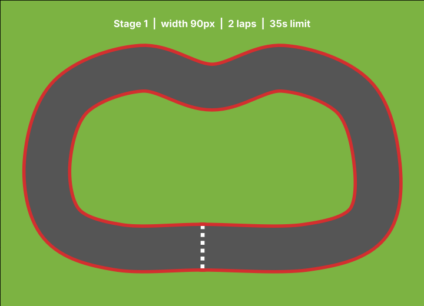
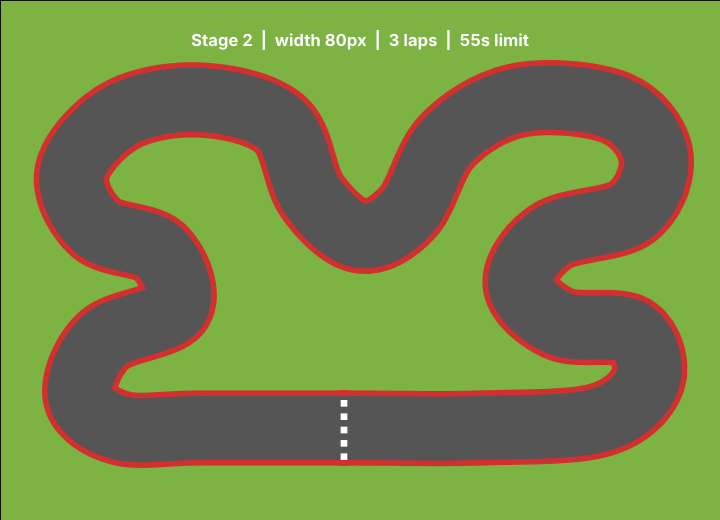
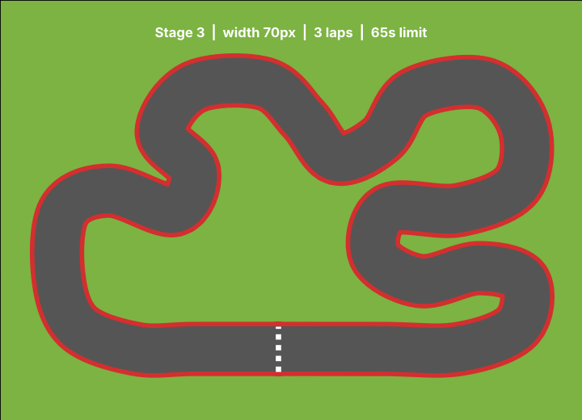

# F1 Racer

A top-down F1-style racing game made with Python's built-in `turtle` module.
Drive your car around winding race tracks, stay on the asphalt, collect coins and clear all stages before the time runs out.


## Features

- **3 stages** with different tracks. Higher stages have narrower roads and sharper corners.
- **F1-style tracks** with red and white kerbs and a checkered finish line, built from smooth Catmull-Rom spline curves.
- **Realistic driving**: acceleration, braking, reverse and friction. Steering is weaker at low speed.
- **Grass penalty**: if the car leaves the asphalt partly, its speed drops to 2.5.
- **Off-track check**: if the whole car leaves the track, the race is over.
- **Lap counting with a checkpoint**: driving back and forth across the finish line does not count as a lap.
- **Coins**: each coin takes 1 second off your time. Coins are placed again on every lap.
- **Time limit** for every stage.
- **Best record**: the best total time of all stages is saved in `best_total.txt` and is kept after the game is closed.

## Stages

| Stage | Track width | Laps | Time limit | Track |
|---|---|---|---|---|
| 1 | 90 px | 2 | 35 s |  |
| 2 | 80 px | 3 | 55 s |  |
| 3 | 70 px | 3 | 65 s |  |

## Controls

| Key | Action |
|---|---|
| `↑` | Accelerate |
| `↓` | Brake / reverse |
| `←` `→` | Steer |
| `Space` | Start / retry / next stage |

## Game rules

1. Press `Space` to start a stage.
2. Finish all laps of the stage within the time limit.
3. If you leave the track completely, you get **OFF TRACK!**. If the time runs out, you get **TIME OVER!**. Press `Space` to try the same stage again.
4. After finishing a stage you get **STAGE CLEAR!**. Press `Space` to go to the next stage.
5. Finish all 3 stages to become **CHAMPION!**. Your total time is compared with the best record.

## Requirements

- Python 3.8 or later
- No extra packages are needed (`turtle`, `math`, `random`, `time` are part of the Python standard library)

## How to run

```bash
git clone https://github.com/<your-id>/f1-racer.git
cd f1-racer
python car_racer.py
```

On Windows, if `python` is not recognized, use `py car_racer.py`.

## Project structure

```
f1-racer/
├── car_racer.py      # game source code
├── images/           # screenshots and track images for README
├── README.md
└── LICENSE
```

## How it works

| Part | Description |
|---|---|
| `STAGES` | List of stages. Each stage has a track width, number of laps, time limit and control points of the track. |
| `build_track()` | Turns the control points into a smooth closed curve using Catmull-Rom spline interpolation. |
| `segment_distance()` | Distance from the car to a track segment. Used to check grass and off-track. |
| `car_parts()`, `register_car()` | Draw the car as a compound turtle shape (body, stripes, windows, lights, spoiler). |
| `PlayerCar` | The player's car. Handles key input, speed, steering and grass slowdown. |
| `RaceGame` | Main game class. Draws the track, kerbs and finish line, places coins, counts laps, checks time and off-track, and moves between stages. |

Lap counting: the track is a list of points. The game finds the nearest point to the car every frame. A lap is counted only when the car crosses the finish line forward **after** passing the middle part of the track (checkpoint).

## How to add a new track

Add a new item to `STAGES` in `car_racer.py`:

```python
{'width': 75, 'laps': 3, 'limit': 60, 'track': [
    (-20, -200), (200, -200), ...
]},
```

The first point is the finish line. Keep points inside x: -360 ~ 370 and y: -215 ~ 200, and keep different parts of the road far enough from each other.

## References and acknowledgements

- This project is extended from the **Turtle Runaway** lab of the Open Source Software course. The game loop structure (`ontimer` step loop, key press/release handling, banner and HUD, best score) is based on that lab code.
- Python `turtle` documentation: https://docs.python.org/3/library/turtle.html
- Catmull-Rom spline: https://en.wikipedia.org/wiki/Centripetal_Catmull%E2%80%93Rom_spline
- Parts of the code were written with the help of an AI assistant (Claude by Anthropic). I reviewed, tested and adjusted all of the code.

## License

This project is licensed under the [MIT License](LICENSE).
